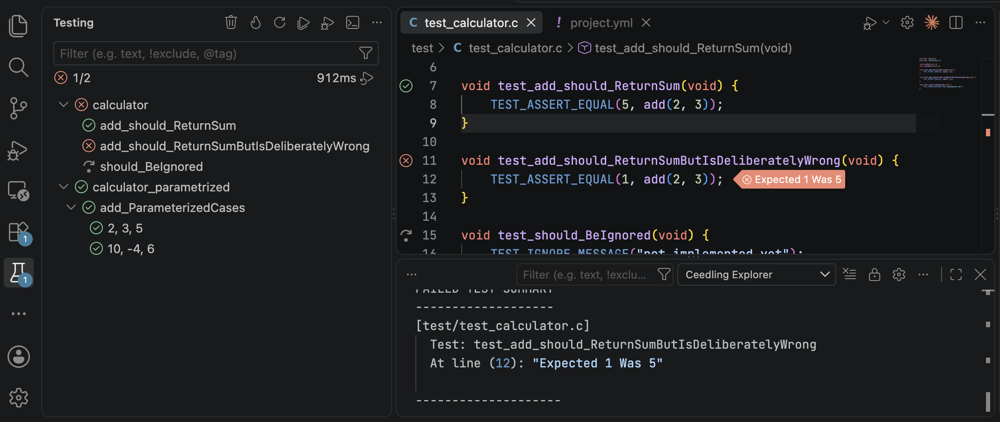
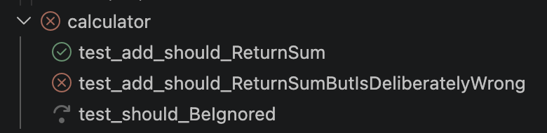
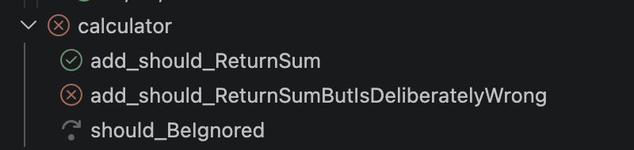
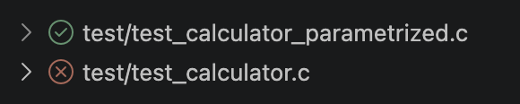
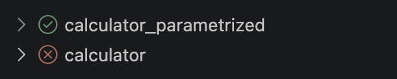
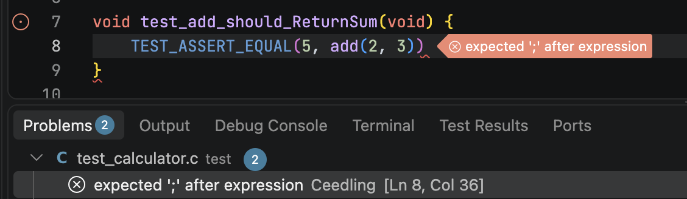

# 🌱 Ceedling Visual Studio Code Extension

This Visual Studio Code [extension][marketplace] runs your [Ceedling] test suite from VS Code’s built-in _Testing_ view. Ceedling is a handy-dandy build system for C projects.



[Ceedling]: https://github.com/ThrowTheSwitch/Ceedling
[marketplace]: https://marketplace.visualstudio.com/items?itemName=throw-the-switch.vscode-ceedling

## Supporting this work

Ceedling and its complementary [ThrowTheSwitch] pieces and parts are and always will be freely available and open source.

💼 **_[Ceedling Suite][ceedling-suite]_** is a growing collection of paid products and services built around Ceedling to help you do even more.
**_[Ceedling Assist][ceedling-assist]_** for support contracts and training is now available.

🙏🏻 **[Please consider supporting Ceedling and this extension as a Github Sponsor][tts-sponsor]**

[ThrowTheSwitch]: https://github.com/ThrowTheSwitch
[ceedling-suite]: https://www.thingamabyte.com/ceedling
[ceedling-assist]: https://www.thingamabyte.com/ceedlingassist
[tts-sponsor]: https://github.com/sponsors/ThrowTheSwitch

# Features

The extension brings your Ceedling tests into VS Code’s own testing tools.

* Lists every test file, test function, and parametrized test case in the _Testing_ view, with each one’s state.
* Adds run and debug icons beside each test in the editor’s gutter.
* Shows a failed test’s message at its failing line, in the _Testing_ view and in the editor.
* Runs a single test function without running the rest of its file.
* Keeps the test list current as you edit, add, or remove tests.
* Reports compiler and linker problems in the editor and the _Problems_ panel, when configured.
* Supports several Ceedling projects per workspace, and Ceedling mixins.
* Reports code coverage through VS Code’s built-in coverage UI, from Ceedling’s gcov plugin.

# Requirements

The extension needs a recent VS Code and Ceedling 1.0.0 or later.

## VS Code

Requires VS Code 1.88.0 or later.

## Ceedling

Requires Ceedling 1.0.0 or later. Ceedling 1.0.0 through 1.2.1 are supported. [Code coverage](#code-coverage) also needs Ceedling’s gcov plugin and a coverage report tool.

_[Ceedling documentation](https://throwtheswitch.github.io/Ceedling/latest/)_

## Parameterized Unity test cases

Parametrized tests need one project setting. Unity’s `TEST_CASE()`, `TEST_RANGE()`, and `TEST_MATRIX()` require `:unity` ↳ `:use_param_tests:` ⇒ `true`. The _Testing_ view lists each case separately only when this setting is enabled, just as Ceedling runs them.

Ceedling 1.0.0 also needs test-file preprocessing off. Set `:project` ↳ `:use_test_preprocessor` to `:none` (the default) or `:mocks`. Ceedling 1.0.0 loses these markers in preprocessing. Ceedling 1.1.0 and later support parametrized tests with or without it.

# Getting started

Most projects need no configuration at all.

* Install the extension.
* Open the folder or workspace containing your Ceedling project.
* If your project file isn’t at the folder’s root, set its path in [`ceedlingExplorer.projects`](#options).
* If Ceedling runs only in a particular shell (common on Windows), set [`ceedlingExplorer.shellPath`](#options).
* Open the _Testing_ view, and run tests from it or from the gutter icons.

The extension reads your project’s configuration with [`ceedling dumpconfig`][dumpconfig-docs]. It always applies its own [mixin](#mixins), which enables the `report_tests_log_factory` plugin’s `cppunit` report. That XML report is where the extension reads results, so no manual plugin setup is required.

The _Testing_ view keeps itself current. Editing a test file updates its tests as you type, even before you save. Adding or removing a test file, or changing `project.yml` or a mixin file, rediscovers the project.

[dumpconfig-docs]: https://throwtheswitch.github.io/Ceedling/1.1.0/getting-started/command-line/#ceedling-dumpconfig-filepath-sections

# Running and debugging tests

Run and debug tests from the _Testing_ view, or from the gutter beside a test in the editor.


Running a single test function runs only that function. Ceedling still compiles its whole file. All the cases of a parametrized function run together, since Ceedling selects tests by function.

The _Testing_ view’s toolbar also has Clean and Clobber buttons. They run `ceedling clean` and `ceedling clobber` in every Ceedling project in the workspace, after any test run in progress finishes.

# Code coverage

_Run with Coverage_ runs tests through Ceedling’s gcov plugin and shows what they executed in VS Code’s coverage views. The _Test Coverage_ panel lists each source file’s line, branch, and function coverage. In the editor, inline coverage marks each line’s hit count and each branch’s outcome.

The _Testing_ view offers _Run with Coverage_, beside _Run_ and _Debug_, while a project enables the gcov plugin. A coverage run rebuilds your tests with coverage instrumentation, which is slower. Plain runs don’t pay that cost, since only coverage runs use the plugin.

## Setting up coverage

Coverage needs Ceedling’s [gcov plugin][gcov-plugin], `gcov` from your GCC toolchain, and one of two report tools: [gcovr] or [ReportGenerator]. The extension reads the Cobertura XML report either tool writes.

1. Install `gcovr` (e.g. `pip install gcovr`) or ReportGenerator (`dotnet tool install -g dotnet-reportgenerator-globaltool`), where Ceedling runs. ReportGenerator, a .NET tool, is common on Windows.
2. Enable the plugin and a Cobertura report, in `project.yml` or a [mixin](#mixins):

    ```yaml
    :plugins:
      :enabled:
        - gcov
    :gcov:
      :utilities:
        - gcovr           # or ReportGenerator, or both
      :reports:
        - Cobertura       # the report the extension reads; add any others you want
    ```

3. Choose _Run with Coverage_ in the _Testing_ view, for a test, a file, or a whole project.

A mixin keeps coverage settings out of `project.yml`. Save the YAML above as, e.g., `coverage.yml`, and add it to [`ceedlingExplorer.mixins`](#options). Every run then has the plugin available, and only coverage runs use it.

## How coverage runs work

A coverage run uses Ceedling’s `gcov:` tasks in place of `test:` tasks. Test results appear in the _Testing_ view exactly as for a plain run.

- **One run, one measurement.** Each coverage run shows only what it executed. The tools report every coverage counter in the build directory, so the extension clears the counters earlier runs left before each coverage run. To accumulate coverage across runs instead, as Ceedling itself does until `ceedling clean` or `clobber`, set `ceedlingExplorer.coverageResetsCounters` to `false`. Two coverage runs at once in the same build directory share its counters, so each may show some of the other’s coverage.
- **Which report.** With both tools enabled, the extension reads gcovr’s report.
- **Deferred reports.** With `:gcov:` ↳ `:report_task: TRUE`, reports come only from Ceedling’s `report:gcov` task. A coverage run adds that task to its own command line.
- **Several projects.** A run spanning projects shows their coverage together. A source file that several projects test shows their combined hits.
- **Projects without the plugin.** A coverage run still runs their tests, and a notification says why they have no coverage.
- **Same-named test files.** Before Ceedling 1.2.1, `gcov:` tasks take a test file’s name without its directory, so they can’t tell apart same-named test files in different directories. Ceedling 1.2.0 then stops with an ambiguous file reference error, and earlier versions may run the other file. The extension warns in its log when that applies. Ceedling 1.2.1 and later take the file’s path, as `test:` tasks do.

## What each tool reports

gcovr and ReportGenerator write the same report format but differ in what they include.

- **Sources outside the project.** gcovr reports only files beneath its `:gcov:` ↳ `:gcovr:` ↳ `:report_root:`, which defaults to the project directory. To include sources above the project, set it to a directory that holds them all, e.g. `".."`. ReportGenerator includes every source directory in `:paths:`.
- **Functions.** The _Test Coverage_ panel lists functions when the report names them. ReportGenerator does. gcovr does in some versions, e.g. 8.6, and not in others, e.g. 5.0 and 7.2. Line and branch coverage appear either way.
- **Sources earlier runs built.** ReportGenerator lists every source an earlier coverage build compiled, at 0% when this run didn’t execute it. gcovr leaves those out.

## When no coverage appears

A run can show no coverage for a handful of reasons, and a notification names most of them. The _Test Results_ panel holds Ceedling’s full output.

- **No Cobertura report configured.** A notification says to add `Cobertura` to `:gcov:` ↳ `:reports:`.
- **No report tool.** The report tool isn’t installed where Ceedling runs, or isn’t on its `PATH`. A notification names the report it expected.
- **No sources in the report.** A notification says so. gcovr reports only sources beneath its `:report_root:`, as above.
- **A failed build.** No report is written, and the _Testing_ view shows the build’s errors.

[gcov-plugin]: https://throwtheswitch.github.io/Ceedling/latest/plugins/gcov/
[gcovr]: https://gcovr.com/
[ReportGenerator]: https://reportgenerator.io/

# Configuration

Settings live under `ceedlingExplorer` in VS Code’s settings.

## Options

Read each property below as `ceedlingExplorer.<property>`.

| `ceedlingExplorer` Property | Description |
|---|---|
| `.projects` | An array of the Ceedling projects to use, each with a path relative to the workspace folder. See [below](#ceedlingexplorerprojects-properties) for its `path`, `debugLaunchConfig`, `name`, and `mixins` properties. |
| `.mixins` | An array of [Ceedling mixins](#mixins), lowest to highest priority, applied to every project that doesn’t define its own `mixins`. Each is a name, a built-in toolchain target (e.g. `gcc` or `clang`), or a file path. By default it is `[]`. |
| `.shellPath` | The path to the shell Ceedling runs in. By default, or when set to `null`, it is the operating system’s default shell. |
| `.ceedlingCommand` | The command that runs Ceedling. By default it is `ceedling`. Set it to, e.g., `bundle exec ceedling` or the path to a vendored Ceedling. |
| `.prettyTestLabel` | Shortens each test’s label in the _Testing_ view by dropping its prefix, e.g. `test_BlinkTaskShouldToggleLed` becomes `BlinkTaskShouldToggleLed`. By default it is `true`.<br><br>Inactive:<br><br><br> Active:<br>|
| `.prettyTestFileLabel` | Shortens each test file’s label by dropping its path, prefix, and extension, e.g. `test/LEDs/test_BlinkTask.c` becomes `BlinkTask`. By default it is `true`.<br><br>Inactive:<br><br><br> Active:<br> |
| `.testCommandArgs` | The command line arguments that run a test file. The first must contain the `${TEST_ID}` tag, which becomes the test file. With Ceedling 1.2.0 and later that is the file’s project-relative path (e.g. `test/unit/test_foo.c`), which tells same-named test files apart. With earlier versions it is the file’s name alone. By default it is `["test:${TEST_ID}"]`. Coverage runs use `.coverageCommandArgs` instead. |
| `.coverageCommandArgs` | The command line arguments that run a test file with [coverage](#code-coverage). The first must contain the `${TEST_ID}` tag, which becomes the test file. With Ceedling 1.2.1 and later that is the file’s project-relative path, as for `.testCommandArgs`. With earlier versions it is the file’s name alone, as their `gcov:` tasks require. By default it is `["gcov:${TEST_ID}"]`. |
| `.coverageResetsCounters` | Whether each [coverage](#code-coverage) run clears the coverage counters earlier runs left, so it shows only what it executed. By default it is `true`. |
| `.problemMatching` | Compiler and linker problem matching. See [Problem matching](#problem-matching). |
| `.ansiEscapeSequencesRemoved` | Whether ANSI escape sequences are removed from Ceedling’s output. By default it is `true`. |

### `ceedlingExplorer.projects` properties

Each `ceedlingExplorer.projects` entry describes one Ceedling project.

- `path` names the project. It is either a directory holding a `project.yml` file, or another .yml file applied over the `project.yml` beside it. With Ceedling 1.2.0 and later, `ceedling.yml` works in place of `project.yml`, but a directory may not hold both. The path is relative to the workspace folder.
- `debugLaunchConfig` is the *name* of the `launch.json` configuration that debugs this project’s tests. See [Debugging](#debugging).
- `name` (optional) labels the project’s tests in the _Testing_ view.
- `mixins` (optional) are this project’s own [mixins](#mixins), lowest to highest priority. Without it, the project uses `ceedlingExplorer.mixins`. An explicit `[]` opts the project out of that workspace-wide list.

## Mixins

A [Ceedling mixin][mixins-docs] is a YAML fragment merged into a project’s configuration at build time. Mixins suit toolchain targets, CI-specific overrides, and any configuration you don’t want copied into every `project.yml`. Configure them with `ceedlingExplorer.mixins` and `ceedlingExplorer.projects[].mixins` (see [Options](#options)). Later entries win on conflicts, matching Ceedling’s own `--mixin` precedence.

The extension always applies one more mixin, after any you configure. It enables the `report_tests_log_factory` plugin’s `cppunit` report, which the _Testing_ view reads results from. This mixin always has the highest priority, so no setting of yours can disable test reporting. Enabling `report_tests_log_factory` yourself as well is harmless.

The extension warns once if the CppUnit report has a non-default name. That happens when `project.yml` or one of your mixins sets `:report_tests_log_factory` ↳ `:cppunit` ↳ `:filename`. The extension still finds the report. The warning only points out the unusual location in case it wasn’t intended.

[mixins-docs]: https://throwtheswitch.github.io/Ceedling/1.1.0/configuration/mixins/

## Problem matching

Problem matching reports compiler and linker problems in the editor and the _Problems_ panel. It scans Ceedling’s output for known error, warning, and info lines, much as VS Code’s _Tasks_ `problemMatchers` do.



### Problem matching configuration options

Two properties select the patterns used.

| Property | Description |
|---|---|
| `mode` | `"disabled"`, a preset such as `"gcc"`, or `"patterns"` for the custom patterns below. By default it is `"disabled"`. |
| `patterns` | Custom pattern objects. With `mode` set to `"patterns"`, each scans Ceedling’s output line by line. By default it is `[]`. |

The `gcc` preset suits most projects:
```json
"ceedlingExplorer.problemMatching": {
	"mode": "gcc"
}
```

### Problem matching pattern options

Each custom pattern is a regular expression plus the indexes of its capture groups.

| Property | Description |
|---|---|
| `scanStdout` | Scan Ceedling’s stdout for problems. By default it is `false`. |
| `scanStderr` | Scan Ceedling’s stderr for problems. Compilers write their diagnostics there. By default it is `true`. |
| `severity` | The severity of problems this pattern finds: `"error"`, `"warning"`, or `"info"`. By default it is `"info"`. |
| `filePrefix` | Prepended to a relative file path to make it absolute. `${projectPath}` becomes the project’s directory. An empty string, the default, means reported paths are already absolute. |
| `regexp` | The regular expression matching a problem line, in ECMAScript (JavaScript) syntax. [regex101](https://regex101.com/) helps while experimenting. Required. |
| `message` | The capture group holding the problem’s message. Required. |
| `file` | The capture group holding the problem’s file. Required. |
| `line` | The capture group holding the problem’s (first) line. Unused when `null` or absent. |
| `lastLine` | The capture group holding the problem’s last line. Unused when `null` or absent. |
| `column` | The capture group holding the problem’s (first) column. Unused when `null` or absent. |
| `lastColumn` | The capture group holding the problem’s last column. Unused when `null` or absent. |

This pattern matches GCC compiler warnings:
```json
{
    "severity": "warning",
    "filePrefix": "${projectPath}",
    "regexp": "^(.*):(\\d+):(\\d+):\\s+warning:\\s+(.*)$",
    "message": 4,
    "file": 1,
    "line": 2,
    "column": 3
}
```

# Commands

Two commands are available in the Command Palette and as _Testing_ view toolbar buttons. Use their IDs to bind keyboard shortcuts. Running, debugging, and refreshing tests use VS Code’s own _Testing_ view commands.

| ID | Command |
|---|---|
| `ceedlingExplorer.clean` | Run `ceedling clean` |
| `ceedlingExplorer.clobber` | Run `ceedling clobber` |

# Debugging

Debugging a test uses a `launch.json` configuration you provide. Reference its *name* as the `debugLaunchConfig` of the project’s `ceedlingExplorer.projects` entry (see [Options](#options)). Without any `ceedlingExplorer.projects` entry, the extension expects a configuration literally named `ceedling`.

Use `${command:ceedlingExplorer.debugTestExecutable}` in the configuration’s `program` to name the test executable. It is a path under `build/test/out/` in the project. Debugging must start from a test’s debug icon in the _Testing_ view, where the extension replaces this token with the executable’s path. Starting the same configuration with F5 or from the _Run and Debug_ panel skips that step. A clear error then explains what happened, instead of a confusing “path does not exist” failure.

Debugging builds and runs the test file first, then starts the debugger. The _Testing_ view shows that run’s real results.

Debugging always covers a whole test file. Ceedling compiles and runs each test file as one executable, so debugging a single parametrized case still debugs its entire file. Set or skip breakpoints accordingly. Debugging several files at once debugs only the first, with a notification saying so.

Migrating from the original _Ceedling Test Explorer_ extension? Its `ceedlingExplorer.debugConfiguration` setting no longer exists. Use `ceedlingExplorer.projects[].debugLaunchConfig` instead.

This example configuration uses Microsoft’s C/C++ extension (`ms-vscode.cpptools`):
```json
{
    "name": "Ceedling Test Explorer Debug",
    "type": "cppdbg",
    "request": "launch",
    "program": "${workspaceFolder}/build/test/out/${command:ceedlingExplorer.debugTestExecutable}",
    "args": [],
    "stopAtEntry": false,
    "cwd": "${workspaceFolder}",
    "environment": [],
    "externalConsole": false,
    "MIMode": "gdb",
    "miDebuggerPath": "C:/MinGW/bin/gdb.exe",
    "setupCommands": [
        {
            "description": "Enable pretty-printing for gdb",
            "text": "-enable-pretty-printing",
            "ignoreFailures": true
        }
    ]
}
```

# Crashes and `:use_backtrace`

A crashing test is caught without the debugger. Ceedling’s own `:use_backtrace` project setting, [documented here][use-backtrace-docs], reports a crash as a normal failed test at the crashing line. Without it, a crash ends in a bare timeout or a silently stopped run. This extension shows that result like any other failed test, with no extra configuration.

The default, `:simple`, reruns each test case alone to find which one crashed. It needs no gdb. It also works with a simulator-based test fixture, not just native hardware.

`:gdb` also finds the exact crashing line. On Ceedling 1.1.0 and later it writes a gdb log file per test case, and this extension turns the log’s reference into a clickable link. `:gdb` needs gdb installed. It supports only the native build platform, not a cross-compiled or simulator-based test fixture. Stay on `:simple` if either applies.

[use-backtrace-docs]: https://throwtheswitch.github.io/Ceedling/1.1.0/configuration/reference/project/#use_backtrace

# Troubleshooting

Check [Known Issues](docs/KnownIssues.md) first if you think you’ve found a bug. If it isn’t there, please [file a bug report](https://github.com/throwtheswitch/vscode-ceedling/issues).

# Documentation

These companion documents cover changes and contributions.

* [Changelog](CHANGELOG.md) — a terse, itemized record of what changed in each release.
* [Release Notes](docs/ReleaseNotes.md) — the narrative version, with the highlights worth reading before upgrading.
* [Known Issues](docs/KnownIssues.md) — currently open issues, by version.
* [Breaking Changes](docs/BreakingChanges.md) — what to expect when upgrading across a compatibility boundary.
* [Development](docs/Development.md) — how to work on this extension itself.
* [Architecture](docs/Architecture.md) — how the extension works, and the VS Code APIs it builds on.

# Contributing

Contributions are welcome. See [docs/Development.md](docs/Development.md) for the development workflow, local debugging, and the development sidecar, and [docs/Architecture.md](docs/Architecture.md) for the code’s architecture.

# Acknowledgments

This VS Code extension is a fork of the original _Ceedling Test Explorer_ extension [[Github][ceedling-test-explorer-github], [Marketplace][ceedling-test-explorer-marketplace]] authored by [Kin Numaru](https://github.com/numaru). It was taken over by the [ThrowTheSwitch](https://throwtheswitch.org) community, the authors and maintainers of Ceedling itself, with Kin’s blessing.

Ceedling 1.0.0 compatibility was added to the original extension by merging a [PR][1.0.0-pr] authored by [@simeon-s1](https://github.com/simeon-s1).

Thank you to Kin, @simeon-s1, and all those who contributed to the original repository.

[Acknowledgments.md](docs/Acknowledgments.md) also credits the contributions made to this extension since then.

[ceedling-test-explorer-github]: https://github.com/numaru/vscode-ceedling-test-adapter.git
[ceedling-test-explorer-marketplace]: https://marketplace.visualstudio.com/items?itemName=numaru.vscode-ceedling-test-adapter
[1.0.0-pr]: https://github.com/numaru/vscode-ceedling-test-adapter/pull/139
