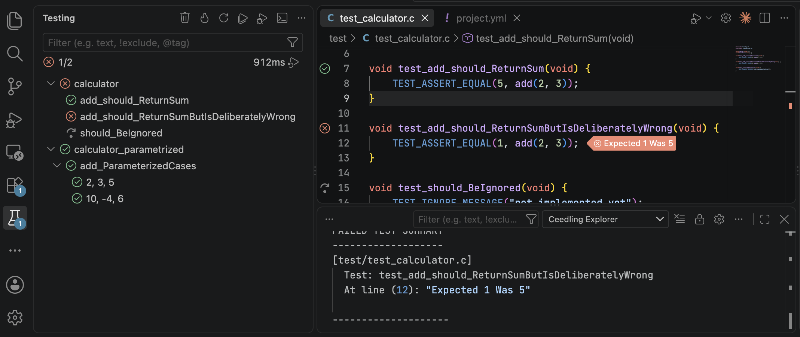

[][docs]

# 🌱 Ceedling Visual Studio Code Extension

This Visual Studio Code [extension][marketplace] runs your [Ceedling] test suite from VS Code’s built-in _Testing_ view. Ceedling is a handy-dandy build system for C projects.

> 📖 **The full documentation lives at [docs.throwtheswitch.org/vscode-ceedling][docs].** It has step-by-step guides, every setting, and troubleshooting, kept current between releases.

[Ceedling]: https://github.com/ThrowTheSwitch/Ceedling
[marketplace]: https://marketplace.visualstudio.com/items?itemName=throw-the-switch.vscode-ceedling
[docs]: https://docs.throwtheswitch.org/vscode-ceedling/latest/

## Supporting this work

Ceedling and its complementary [ThrowTheSwitch] pieces and parts are and always will be freely available and open source.

💼 **_[Ceedling Suite][ceedling-suite]_** is a growing collection of paid products and services built around Ceedling to help you do even more.
**_[Ceedling Assist][ceedling-assist]_** for support contracts and training is now available.

🙏🏻 **[Please consider supporting Ceedling and this extension as a Github Sponsor][tts-sponsor]**

[ThrowTheSwitch]: https://github.com/ThrowTheSwitch
[ceedling-suite]: https://www.thingamabyte.com/ceedling
[ceedling-assist]: https://www.thingamabyte.com/ceedlingassist
[tts-sponsor]: https://github.com/sponsors/ThrowTheSwitch

# Features

The extension brings your Ceedling tests into VS Code’s own testing tools.

* Lists every test file, test function, and parametrized test case in the _Testing_ view, with each one’s state.
* Adds run and debug icons beside each test in the editor’s gutter.
* Shows a failed test’s message at its failing line, in the _Testing_ view and in the editor.
* Runs a single test function without running the rest of its file.
* Keeps the test list current as you edit, add, or remove tests.
* Reports compiler and linker problems in the editor and the _Problems_ panel, when configured.
* Supports several Ceedling projects per workspace, and Ceedling mixins.
* Reports code coverage through VS Code’s built-in coverage UI, from Ceedling’s gcov plugin.

# Requirements

The extension needs VS Code 1.88.0 or later and Ceedling 1.0.0 or later. Ceedling 1.0.0 through 1.2.2 are supported. [Getting Started][getting-started] lists what code coverage and debugging need too.

# Quick start

Most projects need no configuration at all.

1. Install the extension.
2. Open the folder or workspace containing your Ceedling project.
3. If your project file isn’t at the folder’s root, name the project in [`ceedlingExplorer.projects`][projects].
4. If Ceedling runs only in a particular shell, as is common on Windows, set [`ceedlingExplorer.shellPath`][shell-path].
5. Open the _Testing_ view, and run tests from it or from the gutter icons.

The [How-To guides][howto] go further, from code coverage and debugging to projects laid out your own way.

[getting-started]: https://docs.throwtheswitch.org/vscode-ceedling/latest/manual/getting-started/
[projects]: https://docs.throwtheswitch.org/vscode-ceedling/latest/manual/configuration/#ceedlingexplorerprojects
[shell-path]: https://docs.throwtheswitch.org/vscode-ceedling/latest/manual/configuration/#ceedlingexplorershellpath
[howto]: https://docs.throwtheswitch.org/vscode-ceedling/latest/howto/

# Documentation

The documentation site covers using the extension, and this repository holds its release history.

| Page | Covers |
|---|---|
| [How-To][howto] | Step-by-step guides for common goals, each ending with a complete example |
| [User Manual][manual] | How each feature works, from running tests to code coverage, debugging, and problem matching |
| [Configuration][configuration] | Every setting, with its default, plus mixins and commands |
| [Troubleshooting][troubleshooting] | Common symptoms and messages, with their causes and fixes |

* [Changelog](CHANGELOG.md) — a terse, itemized record of what changed in each release.
* [Release Notes](docs/ReleaseNotes.md) — the narrative version, with the highlights worth reading before upgrading.
* [Known Issues](docs/KnownIssues.md) — currently open issues, by version.
* [Breaking Changes](docs/BreakingChanges.md) — what to expect when upgrading across a compatibility boundary.

[manual]: https://docs.throwtheswitch.org/vscode-ceedling/latest/manual/
[configuration]: https://docs.throwtheswitch.org/vscode-ceedling/latest/manual/configuration/
[troubleshooting]: https://docs.throwtheswitch.org/vscode-ceedling/latest/manual/troubleshooting/

# Troubleshooting

Check [Troubleshooting][troubleshooting] and the [Known Issues](docs/KnownIssues.md) first if you think you’ve found a bug. If it isn’t there, please [file a bug report](https://github.com/throwtheswitch/vscode-ceedling/issues).

# Contributing

Contributions are welcome. See [docs/Development.md](docs/Development.md) for the development workflow, local debugging, the development sidecar, and the documentation site. See [docs/Architecture.md](docs/Architecture.md) for the code’s architecture.

# Acknowledgments

This VS Code extension is a fork of the original _Ceedling Test Explorer_ extension [[Github][ceedling-test-explorer-github], [Marketplace][ceedling-test-explorer-marketplace]] authored by [Kin Numaru](https://github.com/numaru). It was taken over by the [ThrowTheSwitch](https://throwtheswitch.org) community, the authors and maintainers of Ceedling itself, with Kin’s blessing.

Ceedling 1.0.0 compatibility was added to the original extension by merging a [PR][1.0.0-pr] authored by [@simeon-s1](https://github.com/simeon-s1).

Thank you to Kin, @simeon-s1, and all those who contributed to the original repository.

[Acknowledgments.md](docs/Acknowledgments.md) also credits the contributions made to this extension since then.

[ceedling-test-explorer-github]: https://github.com/numaru/vscode-ceedling-test-adapter.git
[ceedling-test-explorer-marketplace]: https://marketplace.visualstudio.com/items?itemName=numaru.vscode-ceedling-test-adapter
[1.0.0-pr]: https://github.com/numaru/vscode-ceedling-test-adapter/pull/139
