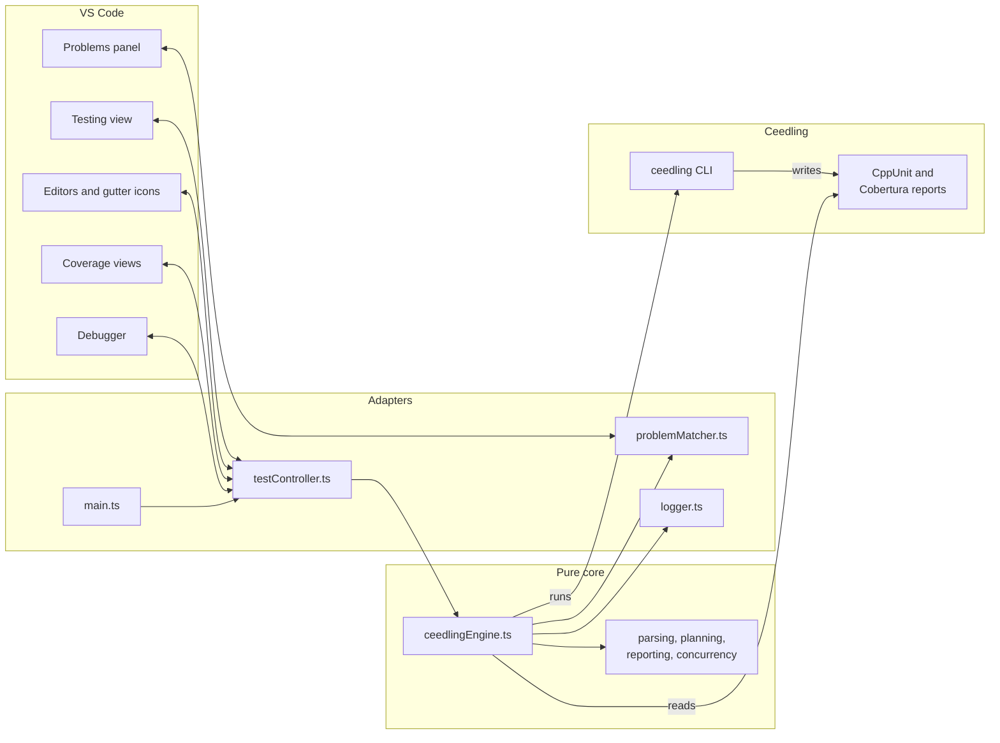
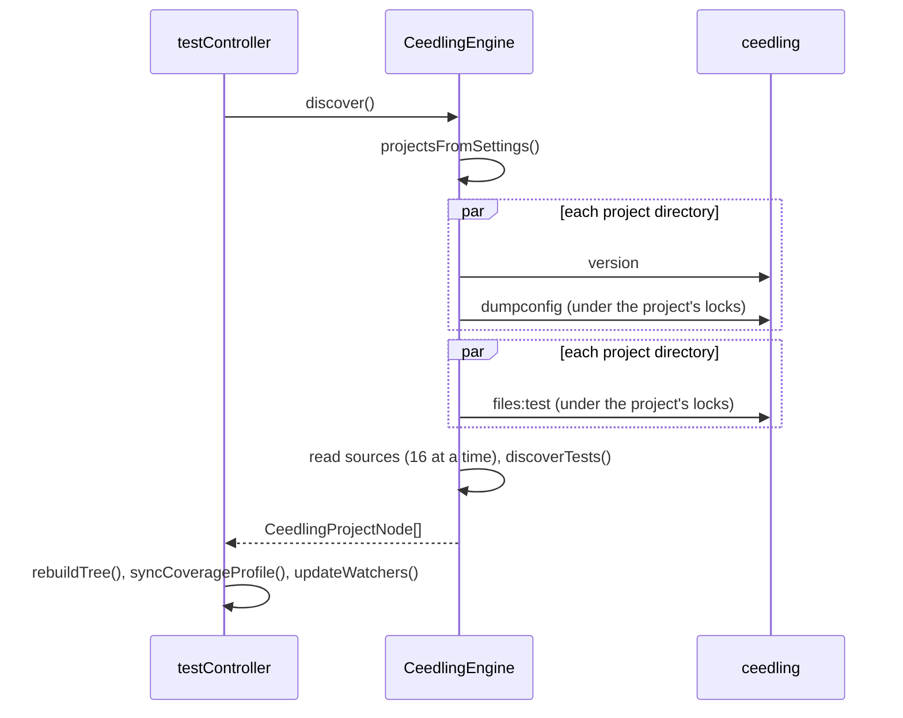
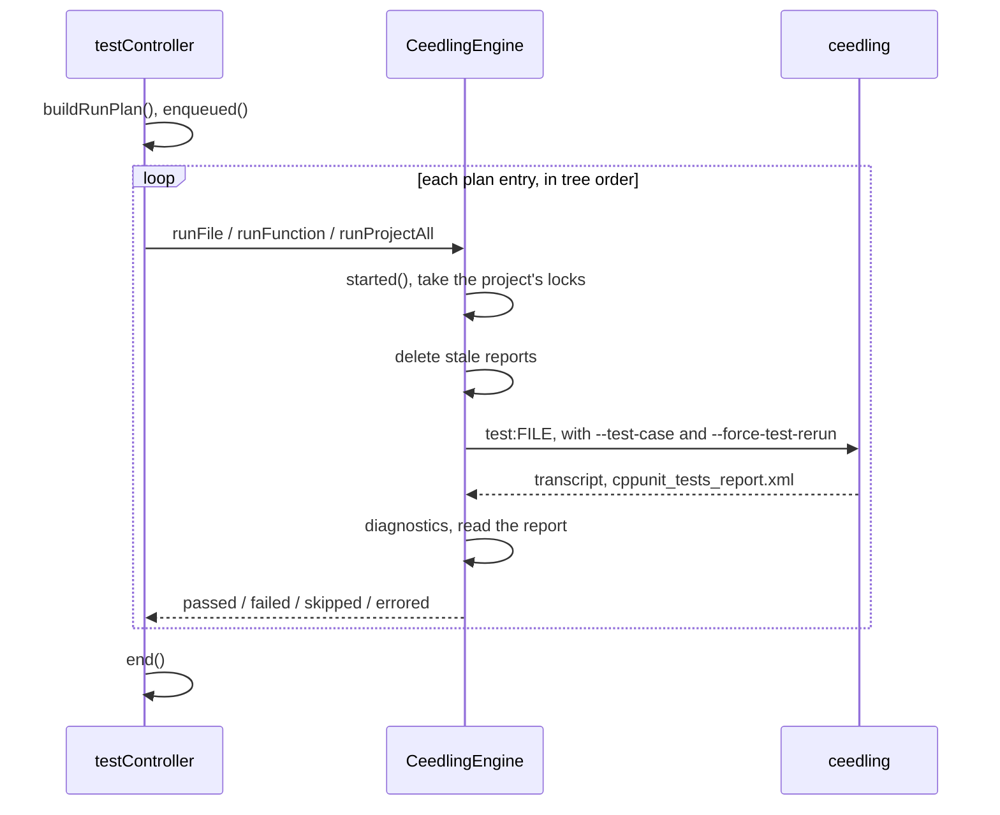
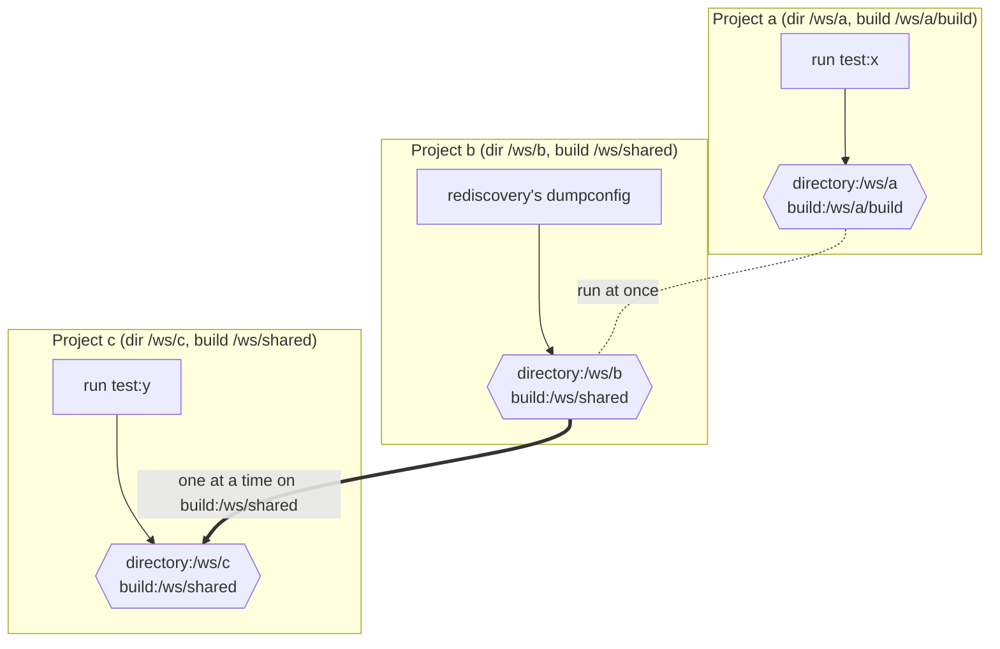

# Architecture

This document explains how the extension works, for contributors and coding agents changing its code. Each section opens with the concepts and moves on to the exact functions, data, and invariants that implement them. [Development.md](Development.md) covers the daily workflow, local debugging, the manual testing plan, and the sidecar.

---

## 1. Overview

The extension connects Ceedling’s command line to VS Code’s native Testing API. Ceedling does the real work. It resolves the project’s configuration, lists its test files, builds and runs the tests, and writes XML reports. The extension finds the tests in source, starts the right Ceedling commands, and maps the reports back onto the tests it found. It reads nothing from `project.yml` itself.

### Two layers

The code has two layers. Most modules have no `vscode` dependency and are unit-tested in plain Node. A thin layer of VS Code adapters wires them to the editor. A decision an adapter makes belongs in a pure module, where a unit test can reach it.

| Module | Layer | Responsibility |
|---|---|---|
| `src/main.ts` | VS Code | Activation, commands, one controller per workspace folder |
| `src/testController.ts` | VS Code | TestItems, run, debug, and coverage profiles, watchers, and the `TestRun` sink |
| `src/problemMatcher.ts` | VS Code | Publishes diagnostics to the Problems panel’s `DiagnosticCollection` |
| `src/logger.ts` | VS Code | The “Ceedling Explorer” log output channel |
| `src/ceedlingEngine.ts` | Pure | Orchestration: discover, run, debug build, coverage, clean, clobber |
| `src/ceedlingProjectConfig.ts` | Pure | Settings → projects; resolved configuration → `ProjectState`; Ceedling version → capabilities |
| `src/ceedlingProcess.ts` | Pure | Running Ceedling, with per-run cancellation |
| `src/unityTestDiscovery.ts` | Pure | Test functions and cases in source, named as Unity names them |
| `src/testResults.ts` | Pure | The CppUnit report, mapped onto discovered ids |
| `src/coberturaReport.ts` | Pure | Cobertura coverage reports, each file’s candidate paths, and merging a run’s reports |
| `src/parsedXml.ts` | Pure | Field access into XML as `xml2js` parses it |
| `src/runPlan.ts` | Pure | A run request → the fewest Ceedling invocations |
| `src/testModel.ts` | Pure | The test tree types, the `RunReporter` interface, and the controller’s label |
| `src/testReporting.ts` | Pure | A `RunReporter` that resolves ids to items and builds plain messages for a `RunSink` |
| `src/debugLaunch.ts` | Pure | The file a debug request debugs, and its launch configuration |
| `src/watchPolicy.ts` | Pure | What settings changes, file events, and edits make the controller do |
| `src/diagnosticsStore.ts` | Pure | Each run scope’s diagnostics, shown by file without duplicates |
| `src/singleFlight.ts` | Pure | Coalesces overlapping discovery requests into one rerun |
| `src/concurrency.ts` | Pure | Grouped concurrent mapping, locks by key, and a limit shared by every caller |
| `src/ceedlingOutputParsing.ts` | Pure | Ceedling stdout, report names, and pretty labels |
| `src/ceedlingMixinArgs.ts` | Pure | The `--project`/`--mixin` flags for a project |
| `src/problemMatching.ts` | Pure | Compiler-output patterns and their matches |

### Two Ceedling constraints

Two Ceedling constraints shape everything else. Ceedling always compiles a whole test file, and its `--test-case` filter narrows a run to one function, never to one parametrized case. Every Ceedling call for a project carries `--project` with its project file, `project.yml` or `ceedling.yml`, then any alternate project file and configured mixins, and last the bundled mixin [`assets/mixins/report-tests-log-factory.yml`](../assets/mixins/report-tests-log-factory.yml). That mixin enables the CppUnit report the extension reads.

## 2. The VS Code APIs it builds on

The extension is a native Testing API client, plus a handful of workspace, debug, diagnostics, and window APIs. Every `vscode` call lives in the four adapter modules. Its minimum, VS Code 1.88, is the release that finalized the test coverage API.

### Activation and lifetime

VS Code activates the extension once startup finishes, or sooner in a workspace containing `project.yml` or `ceedling.yml` (`activationEvents`). `activate()` in `main.ts` creates one `CeedlingTestController` per workspace folder, keyed by folder URI. `workspace.onDidChangeWorkspaceFolders` adds and disposes them, and relabels the rest. `context.extensionMode` selects two variants. `Development` adds Ceedling debug verbosity to runs, and `Test` makes `activate()` return `CeedlingExplorerApi` for the integration tests.

### The Testing API

A `CeedlingTestController` owns at most one `vscode.TestController`, created by `tests.createTestController()` once discovery finds a project. A folder without one adds nothing to the Testing view. A failed discovery keeps the TestController, emptied, until the next discovery.

- **The tree.** `createTestItem()` builds a project item (with several projects), file items, function items, and case items. Function and case items carry a `range`, which places their gutter icons. `items.replace()` and `children.replace()` swap whole levels. A `WeakMap<TestItem, PlanTarget>` maps each item back to what it runs.
- **Handlers.** `resolveHandler` for the root, and `refreshHandler` for the refresh button, both start discovery.
- **Run profiles.** `createRunProfile()` makes three. _Run_ (`TestRunProfileKind.Run`) and _Debug_ (`TestRunProfileKind.Debug`) are defaults. _Coverage_ (`TestRunProfileKind.Coverage`) exists only while some project enables Ceedling’s gcov plugin. `syncCoverageProfile()` creates or disposes it after each discovery.
- **Runs.** `createTestRun()` starts a `TestRun`. `handleRun()` marks every planned item `enqueued()`. The controller’s reporter, which the engine reports through, calls `started()`, `passed()`, `failed()`, `skipped()`, and `errored()`. `handleRun()` calls `end()` once every entry has run. `appendOutput()` takes Ceedling’s transcript, with `\r\n` line ends, as the Test Results terminal needs.
- **Messages.** A `TestMessage` carries a failure’s `location`. A crash’s gdb log becomes a link in a `MarkdownString` message.

### The test coverage API

A coverage run hands VS Code one `FileCoverage` per source file, through `TestRun.addCoverage()`. `FileCoverage.fromDetails()` builds each from its details: a `StatementCoverage` per line, with a `BranchCoverage` per branch outcome, and a `DeclarationCoverage` per function. The Coverage profile’s `loadDetailedCoverage` returns those details when the editor shows inline coverage. VS Code asks with the same `FileCoverage` object it was given, so a `WeakMap` keyed by that object keeps each run’s details its own. Cobertura numbers lines from 1, and VS Code’s `Position` from 0.

### The debug API

Debugging builds a test file, then starts a `launch.json` configuration on its executable. `handleDebug()` reads the configurations through `workspace.getConfiguration('launch')`, splices in the executable path, and calls `debug.startDebugging()`. A unique `__ceedlingDebugRequest` value in the configuration identifies its session in `debug.onDidStartDebugSession` and `debug.onDidTerminateDebugSession`. Cancelling the run calls `debug.stopDebugging()`. The command `ceedlingExplorer.debugTestExecutable` is registered but never contributed. It throws a clear error when a user starts that launch configuration with F5, where VS Code would otherwise resolve `${command:…}` itself.

### Workspace, diagnostics, and window

The remaining APIs keep the tree current and report what happened.

| API | Used for | Where |
|---|---|---|
| `workspace.getConfiguration('ceedlingExplorer', folderUri)` | Settings, scoped to the folder | `testController.ts`, read by the engine through `configProvider` |
| `workspace.onDidChangeConfiguration`, `affectsConfiguration()` | Settings that rediscover or clear diagnostics | `onConfigurationChanged()` |
| `workspace.createFileSystemWatcher(RelativePattern)` | Configuration files and each project directory’s `**/*.c` | `updateWatchers()` |
| `workspace.onDidChangeTextDocument`, `onDidCloseTextDocument` | Reparsing unsaved edits, and dropping them on close | `scheduleReparse()`, `reparse()` |
| `languages.createDiagnosticCollection('Ceedling')` | Compiler problems in the Problems panel | `problemMatcher.ts` |
| `window.createOutputChannel(…, { log: true })` | The “Ceedling Explorer” log, at VS Code’s log level | `logger.ts` |
| `window.showWarningMessage`, `showErrorMessage`, `showInformationMessage` | Notifications, e.g. a coverage problem once a session, or a debug request naming several files | `logger.ts`, `testController.ts` |
| `window.withProgress` | Cancellable Clean and Clobber | `runTask()` |
| `commands.registerCommand` | `clean`, `clobber`, and the debug guard | `main.ts` |

`package.json` contributes the settings, the two commands, and their `view/title` buttons in the Testing view (`when: view == workbench.view.testing`).

## 3. Discovery

Discovery turns settings and Ceedling’s answers into the test tree. `CeedlingTestController.refresh()` calls `CeedlingEngine.discover()` through a `SingleFlight`. `discover()` builds the tree in five steps.

1. `projectsFromSettings()` turns `ceedlingExplorer.projects` and `ceedlingExplorer.mixins` into `CeedlingProject`s: key, absolute path, project file, launch configuration name, and mixins. Projects whose project file exists become the engine’s `candidates`.
2. For each candidate, `checkCeedlingVersion()` runs `ceedling version` in the project directory and requires 1.0.0 or later. `capabilitiesOf()` turns the version into the features this extension may use. See [Ceedling versions](#ceedling-versions).
3. `resolveConfig()` runs `ceedling dumpconfig` with the project’s flags and parses the YAML. Ceedling 1.2.0 writes it to stdout (`--stdout`). Earlier versions write it to a uniquely named temporary file, which is then removed. `projectState()` reads the `ProjectState` from it: `buildRoot`, `reportFilename`, `testPrefix`, `testFilePrefix`, `executableExtension`, `useParamTests`, `reportPluginEnabled`, `coverage`, and `testPaths`.
4. Once every project has loaded, `listTestFiles()` runs `ceedling files:test` and parses its bullets with `parseFileListBullets()`. A failed listing fails discovery, naming each project whose listing failed.
5. `testFileNodes()` reads each file and calls `discoverTests(source, { testPrefix, useParamTests })`. It finds tests in source exactly as Ceedling’s test runner generator does, so every reported result lands on a discovered item. A function’s id is `file::name`, and a case’s is `file::name(args)`, exactly the names in Ceedling’s report.

Steps 2 through 4 run concurrently across project directories, one project at a time within a directory. Their outcomes apply in settings order, so errors read the same however the work interleaves. Sources are read concurrently and parsed in listed order.

The engine replaces its `projects` map only after every project loads. A failed discovery throws `CeedlingLoadError` and leaves the last good map in place for runs. The controller then turns the tree into TestItems. It keeps a `PlanTarget` for each item, and item lookups per project, since ids are unique only within one project.

### Staying current

The controller keeps the tree current without polling. Its refreshes go through the `SingleFlight`, so startup, watchers, and settings changes arriving together cause one discovery plus at most one rerun.

- **Configuration files.** `CeedlingEngine.configurationFiles()` lists every file a project’s configuration can come from, existing or not: both default project files, any alternate project file, and file-path mixins. A watcher on each triggers discovery, so creating a project file in an empty folder starts one.
- **Test sources.** A watcher on each project directory’s `**/*.c` reparses a changed test file alone, through `rediscoverFile()`, with no Ceedling call. A created file that `mayBeTestFile()` accepts, or a deleted test file, triggers discovery, since only `ceedling files:test` knows the full list. `sourceEventEffect()` makes that choice.
- **Unsaved edits.** An open test file is reparsed from its buffer once typing pauses for 400 ms, through a `Debouncer` keyed by file.
- **Settings.** `settingsChangeEffects()` decides. A change to a setting that shapes discovery, such as `projects` or `mixins`, triggers discovery. Turning problem matching off clears its diagnostics. Others apply on the next run.

## 4. Runs

A run turns the request into a plan, then reports each plan entry’s results.

- **Planning.** `buildRunPlan(projects, include, exclude)` returns `RunPlanEntry`s of three kinds. A `project` entry runs `test:all`. A `file` entry runs `test:<file>`. A `function` entry adds `--test-case=<name>`. Excluded items narrow the plan to function granularity at most. The reporter drops their results.
- **Running.** `runTests()` marks every id started, then takes its project’s locks. `buildAndRun()` deletes stale reports in `artifacts/test` and `artifacts/gcov`, runs Ceedling, appends the transcript to the run’s output, updates diagnostics, and reads the newest report.
- **Reporting.** `testResults(report, leafIds)` yields `passed`, `skipped`, `failed`, and `unreported` results. An `unreported` id gets an error naming the likely cause: discovery and Ceedling disagree about its name. With no report at all, every id errors, and the most severe compiler diagnostic leads the message. The controller’s reporter, from `createRunReporter()`, maps each id to its TestItem. It drops results for excluded items and, with a warning, for unknown ids, and turns a crash’s gdb log path into a link.
- **Edge cases.** A `--test-case` run whose report also names another function, from Ceedling’s substring filter, reruns the whole file. A cancelled run kills only its own process tree, through `CeedlingRunner`, and marks its tests skipped.

Diagnostics are keyed by run scope: the project key for a project run, `projectKey::fileId` for a file or function run. A project run replaces its own entry and drops its files’ entries. A file run replaces its own entry and drops the project entry’s diagnostics located in that file.

### Test build directories

Ceedling builds each test file in directories named for it, under `test/out`, `gcov/out`, and the rest of the build root. Debugging needs the executable there, and a coverage collision needs the counters. `testBuildName(testId, testPaths, nested)` in `ceedlingProjectConfig.ts` computes that name exactly as Ceedling does.

- **Before 1.2.0** the name is the test file’s base name, e.g. `test_foo` for `test/unit/test_foo.c`.
- **From 1.2.0** the file’s directory within its test path comes first, e.g. `unit/test_foo`. Ceedling’s `TestBuildSetup` derives it through `PathMirror.relative_subdir` over `:paths` ↳ `:test`, which `ProjectState.testPaths` holds as configured.
- **Roots.** Each test path loses a leading `+:` or `-:` and the whitespace around it. A test path with a glob (`*`, `?`, `{`, `}`) is cut back to the directory before its first glob, so `+:test/**` gives `test`. One led by a glob gives nothing. Subtractive paths count as roots too, as in Ceedling.
- **Choice.** The longest root that equals the file’s directory, or contains it, decides. A file under no root, or directly in one, builds under its base name. Paths compare as written, with backslashes read as `/`.

Ceedling itself refuses some same-named layouts. Take test paths `+:test/unit/**` and `+:extra/**`. `test/unit/test_calc.c` then builds as `test_calc`, and `extra/unit/test_calc.c` as `unit/test_calc`. With real Ceedling 1.2.0 and 1.2.1, every build in that project stops with `EXCEPTION: Ambiguous file reference 'test_calc.c'`. `testBuildName()` still names both directories correctly.

### Debugging

`handleDebug()` debugs one test file. `compileForDebug()` runs the file exactly as a run does and reports its real results. It then returns the executable’s path relative to Ceedling’s test output directory. That path is `<build name>/<name><executableExtension>`, from `testBuildName()`. See [Test build directories](#test-build-directories). `resolveLaunchConfig()` in `debugLaunch.ts` splices that path into every `${command:ceedlingExplorer.debugTestExecutable}` in a copy of the named launch configuration.

### Coverage

A coverage run is an ordinary run with a `RunMode` of `coverage`. The controller creates a fresh one per request with `coverageMode()`. Its `CoverageRun` remembers which counter directories the request has already reset.

- **Configuration.** `coverageState()` reads the resolved configuration. It says whether reports wait for `report:gcov`. It also lists where each enabled utility writes its Cobertura report, relative to the build root, gcovr’s first. ReportGenerator writes `ReportGenerator/Cobertura.xml`, or `ReportGenerator/Cobertura/Cobertura.xml` with several report types. `coverageProblem()` explains a project that writes no Cobertura report.
- **Building.** `commandArgs()` uses `coverageCommandArgs`. Before Ceedling 1.2.1 it passes the bare file name, since the `gcov:` task prepends the test file prefix to a name lacking it. From 1.2.1 it passes the path. It appends `report:gcov` when reports wait for that task. Under the project’s locks, `prepareCoverage()` deletes stale Cobertura reports. Once per counter directory per request, it also deletes the `.gcda` counters, and the `.gcov` files gcov writes from them, under `<build>/gcov/out`, unless `coverageResetsCounters` is off.
- **Collisions.** A `--test-case` collision clears only its test’s own counters before the whole-file fallback. `clearTestCounters()` deletes those beneath the test’s build directory in `gcov/out`, from `testBuildName()`, so same-named test files elsewhere keep theirs.
- **Paths.** Cobertura names files relative to one of its `<source>` roots, or absolutely. `reportedFiles()` gives each file a candidate per source, resolved against the project directory, where Ceedling runs the tools. The engine keeps the first candidate that exists.
- **Showing.** Each build that produced test results reports a `CoverageOutcome` through `RunReporter.coverage()`. A failed build reports one only for a configuration that can’t give coverage. `mergeCoverage()` keeps the last report per report path, and adds up reports from separate build directories. A `missing` outcome becomes a notification and a line in the run’s output.

## 5. Concurrency

The extension overlaps work wherever Ceedling allows it, and serializes it wherever Ceedling shares state. Every Ceedling start costs a Ruby startup, so overlapping discovery across projects saves real time. But two Ceedling commands sharing a build root can corrupt each other’s builds and read each other’s reports.

### What runs at once

Each kind of work has its own bound. Each workspace folder has its own `CeedlingEngine`, so its locks and its read limit apply within that folder only.

| Work | Overlaps with | Bounded by |
|---|---|---|
| Discovery requests | Each other | `SingleFlight`: one discovery plus at most one rerun |
| Project loads and listings within a discovery | Other project directories | `mapGrouped()`: concurrent across directories, in order within one |
| Source reads | Every other read in the engine | `Limiter`: 16 open reads at once |
| Ceedling commands | Commands for projects apart in both directory and build root | `KeyedLock`: one command per key at a time |
| Plan entries of one run request | Nothing | The controller awaits each in turn, so results arrive in tree order |
| Separate run requests | Each other, and discovery | The engine’s locks |
| Reparses of unsaved edits | Each other | `Debouncer`: the latest edit per file, after 400 ms |

### Locks

Every Ceedling command that loads a project runs inside `CeedlingEngine.exclusively(project, work)`: `dumpconfig`, `files:test`, runs, debug builds, and clean or clobber. So does clearing a test’s coverage counters, which deletes files in the build root. Each holds two keys of the engine’s `KeyedLock`.

- `directory:<pathKey(project directory)>` serializes work in one directory, where several projects may share files.
- `build:<pathKey(resolved build root)>` serializes work in one build root, which projects in different directories share when a common mixin sets `:project` ↳ `:build_root`. It is known once `dumpconfig` has resolved the project. A rediscovery’s `dumpconfig` takes the build root the last discovery found, which any build still running uses. Its `files:test` takes the one just resolved.

The build root is where Ceedling’s shared state lives. Before Ceedling 1.2.1, every command that loads a project rewrites the vendored Unity and CMock sources under `build/vendor/` in place, so a second command can leave a build compiling a half-written header. In every version, builds in one build root share its CppUnit report, its Cobertura reports, and its coverage counters. `ceedling version` loads no project and takes no lock.

A project no discovery has loaded yet holds only its directory key, since its build root is what its `dumpconfig` is about to resolve. Before Ceedling 1.2.1, that first `dumpconfig` can rewrite a shared build root’s vendored sources under another project’s build. This happens only for a project added while a sibling sharing its build root runs. Taking every known build root instead would make every discovery wait behind every run.

### Invariants

The concurrency design rests on these invariants. A change that breaks one needs a new argument for safety.

1. **Every Ceedling command except `version` runs inside `exclusively()`.** Callers of `listTestFiles()`, `resolveConfig()`, and `buildAndRun()` hold the project’s locks.
2. **Locks are taken in sorted key order.** `KeyedLock.runAll()` dedupes and sorts its keys, then takes them one at a time, so two callers never each hold a key the other waits for. Within one key, work runs in arrival order.
3. **A build reads its own reports before it releases its locks.** `buildAndRun()` deletes stale CppUnit and Cobertura reports first, and reads the new ones under the same locks, so no other build’s report can pass as this one’s.
4. **Each plan entry uses the project as it was when that entry began.** `discover()` replaces the engine’s `projects` map only after every project loads. An entry already holding its `LoadedProject` keeps its arguments, directory, and build root through a concurrent discovery, failed or not. A later entry of the same request looks its project up afresh.
5. **Cancellation stops only its own work.** `CeedlingRunner` kills only the cancelled command’s process tree. Its tests end skipped, and the locks it held release in `finally`.
6. **Coverage counters reset once per counter directory per request.** `CoverageRun.resetDirectories` records each reset. Two coverage requests at once in one build root share its counters, so each may show some of the other’s coverage. The README documents this.

### Ceedling versions

`capabilitiesOf(version)` in `ceedlingProjectConfig.ts` turns `ceedling version` into the features the engine may use. A build suffix such as `1.2.0-13a540f`, or `1.2.1.dev`, counts as its release.

| Capability | From | Effect |
|---|---|---|
| `dumpconfigStdout` | 1.2.0 | `dumpconfig --stdout`, with no temporary file |
| `forceTestRerun` | 1.2.0 | Every build adds `--force-test-rerun` |
| `pathQualifiedTestTasks` | 1.2.0 | `test:` tasks take the file’s project-relative path |
| `pathQualifiedCoverageTasks` | 1.2.1 | `gcov:` tasks take the path too |
| `ceedlingYml` | 1.2.0 | `ceedling.yml` is a default project file |
| `nestedTestBuilds` | 1.2.0 | A test’s build directories nest under its directory within its test path |

Ceedling 1.2.1 resolves three problems this extension works around ([#1360](https://github.com/ThrowTheSwitch/Ceedling/issues/1360), [#1361](https://github.com/ThrowTheSwitch/Ceedling/issues/1361), [#1362](https://github.com/ThrowTheSwitch/Ceedling/issues/1362)). Not every workaround can go.

- **`--force-test-rerun` stays.** Before 1.2.1, delta builds ignore a changed `--test-case` filter and report another run’s cached results. 1.2.1 resolves that, but in every version a delta build also ignores deleted coverage counters. A coverage run after a reset would then write a valid report with every hit at 0. Plain runs on 1.2.1 could drop the flag, at the cost of _Run_ reporting cached results for an unchanged test. The flag stays for both.
- **Path-qualified `gcov:` tasks are gated.** Before 1.2.1, `gcov:` tasks take a bare name. Ceedling 1.2.0 stops with an ambiguous file reference error on a same-named test file, and earlier versions may run the other one. `commandArgs()` logs a warning for that case.
- **The locks stay.** See the next section.

### Possible speedup: discovery without the lock on 1.2.1

Ceedling 1.2.1 could let discovery skip the build-root lock, so a rediscovery need not wait for a long run. This is not implemented. The evidence so far is suggestive, not conclusive.

**The opportunity.** A rediscovery in a project directory waits behind any run there, because `dumpconfig` and `files:test` take the project’s locks. Before 1.2.1 they must, since both rewrite `build/vendor/`. From 1.2.1, Ceedling brings `build/vendor/` up to date only for test and release builds, writes only changed files, and replaces each whole by renaming a temporary copy.

**The evidence.** A probe on Ceedling 1.2.1.dev listed every file under `build/` before and after `dumpconfig --stdout` and `files:test`. Neither command created or changed any of the 45 files. On 1.2.0 the same commands rewrote 8 vendored files. A stress test looping both commands against six clean `test:all` builds found no failure on either version, so it could not show that skipping the lock is safe, only that the race is rare.

**What a change would need.**
- A capability, e.g. `discoveryWritesNoBuildFiles` from 1.2.1, so earlier versions keep the lock.
- `resolveConfig()` and `listTestFiles()` taking no build-root lock on that capability, while builds, clean, and clobber keep both keys. The directory key could go too, unless two projects in one directory need it for another reason.
- A real-Ceedling stress gate in which discovery overlaps builds in the same directory and build root, with results checked exactly, before and after the change.

**The risks.** Discovery may create directories under `build/`, which the probe did not check. A later Ceedling could start writing there again, so the capability must stay pinned to versions that have been checked. And `clean` or `clobber` overlapping a discovery would still need their locks.

## 6. Test seams

The pure core is tested through injected collaborators, and the adapters through a real VS Code running a fake Ceedling.

`CeedlingEngine` takes its collaborators through its constructor’s `deps`. Unit tests replace each one.

- `configProvider` returns settings, normally `vscode.workspace.getConfiguration`.
- `problemMatcher` is the Problems panel adapter.
- `runner` is a `CeedlingRunner`, itself built on an injectable `exec`, `kill`, and environment.
- `fileSystem` implements `EngineFileSystem`.
- `platform` and `tmpdir` default to the host’s.

[`tests/unit/ceedlingEngine.test.ts`](../tests/unit/ceedlingEngine.test.ts) drives the engine against `FakeCeedling`, a simulated Ceedling with an in-memory filesystem. Golden fixtures captured from real Ceedling releases pin discovery and report parsing. See [`tests/fixtures/README.md`](../tests/fixtures/README.md).

The integration tests run the built extension in a real VS Code, on two workspace folders. One has no Ceedling project. The other is a temporary copy of [`tests/fixtures/workspace-fake-ceedling`](../tests/fixtures/workspace-fake-ceedling), whose `ceedlingExplorer.ceedlingCommand` runs a fake Ceedling: a Node script that answers each command from the project’s scenario file. The tests then cover the wiring that unit tests can’t:
- the tree built from discovery;
- results and failure locations in the Testing view;
- compiler errors in the Problems panel;
- cancellation;
- watchers and unsaved edits;
- the Coverage profile, and file coverage and its details reaching VS Code.

On Windows they also run the engine with Windows paths. VS Code’s API can’t read another extension’s TestItems or run results, so `activate()` returns a small handle for the tests, `CeedlingExplorerApi`. See [`tests/integration/main.ts`](../tests/integration/main.ts).
