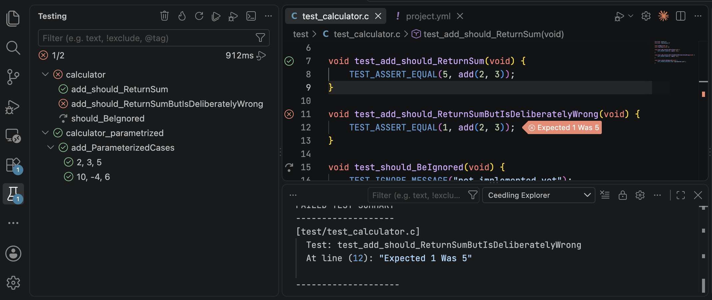

# Ceedling for Visual Studio Code

This [Visual Studio Code][vscode] extension runs your [Ceedling] test suite from VS Code’s built-in _Testing_ view. It lists every test file, test function, and parametrized case, and runs or debugs any of them from the view or the editor. It also reports failures at their lines, compiler problems in the editor, and code coverage in VS Code’s own coverage views.

## Quick start

!!! tip "New to Ceedling?"

    Ceedling is a build system for C projects that specializes in unit test builds orchestrated around the Unity and CMock projects. [Ceedling’s own documentation][ceedling-docs] explains how to set up a project, write tests, and configure builds.

Most VS Code Ceedling projects need no special configuration. Install the extension, open your Ceedling project’s folder, and the _Testing_ view lists your tests.

[Start Testing :material-arrow-right:][first-run]{ .md-button .md-button--primary } [Marketplace Install :material-download-circle-outline:][marketplace]{ .md-button }

## Documentation

-   :material-map-marker-path: **[How-To][howto]**

    ---

    Step-by-step guides for common goals, from a first run to code coverage, debugging, and projects layout. Each ends with a complete, working example.

-   :material-book-open-variant: **[User Manual][manual]**

    ---

    How each feature works, from getting started to problem matching, and every setting with its default.

-   :material-stethoscope: **[Troubleshooting][troubleshooting]**

    ---

    Common symptoms and messages, with their causes and fixes.

-   :material-history: **[Releases][releases]**

    ---

    What changed in each release, known issues, and what to do when upgrading.

-   :material-lifebuoy: **[Help][help]**

    ---

    Reporting bugs, getting support and training, and supporting the project.

[vscode]: https://code.visualstudio.com/
[Ceedling]: https://github.com/ThrowTheSwitch/Ceedling
[marketplace]: https://marketplace.visualstudio.com/items?itemName=throw-the-switch.vscode-ceedling
[ceedling-docs]: https://docs.throwtheswitch.org/Ceedling/latest/
[first-run]: howto/first-run.md
[howto]: howto/index.md
[manual]: manual/index.md
[troubleshooting]: troubleshooting.md
[releases]: releases.md
[help]: help.md

  
