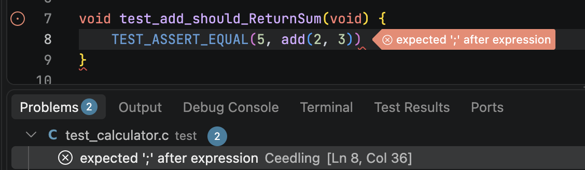

# Problem Matching

Problem matching reports compiler and linker problems in the editor and the _Problems_ panel. It scans Ceedling’s output for known error, warning, and info lines, much as the `problemMatcher` of VS Code’s _Tasks_ does. This page covers the setting’s two fields and every property of a custom pattern. The [compiler problems guide][problems-guide] has patterns for common compilers and linkers.

{ width="540" }

## Turning it on

Problem matching is off by default. The [`ceedlingExplorer.problemMatching`][setting] setting turns it on, and the `gcc` preset suits most projects.

```json
"ceedlingExplorer.problemMatching": {
    "mode": "gcc"
}
```

Ceedling shows a compiler’s or linker’s output only when that tool fails, so problems appear from failed builds. A file that compiles with only warnings shows none, at Ceedling’s default verbosity. Every build that finishes scans its output, and a cancelled build scans none. A test file’s build replaces the problems its last build reported, and a project’s build replaces those of every build in the project. A fixed problem therefore clears with the next build of the test file or project that reported it. Setting `mode` to `"disabled"` clears every problem at once.

## The setting’s fields

Two fields select the patterns used.

| Field | Description |
|---|---|
| `mode` | `"disabled"`, the `"gcc"` preset, or `"patterns"` for the custom patterns below. By default it is `"disabled"`. |
| `patterns` | Custom pattern objects. With `mode` set to `"patterns"`, each one scans Ceedling’s output line by line. By default it is `[]`. |

## Pattern properties

Each custom pattern is a regular expression, plus the indexes of its capture groups. A match reports one problem, at the file and lines its groups capture.

| Property | Description |
|---|---|
| `regexp` | The regular expression matching a problem line, in ECMAScript (JavaScript) syntax. In JSON, each backslash is doubled. [regex101] helps while experimenting. Required. |
| `message` | The capture group holding the problem’s message. Required. |
| `file` | The capture group holding the problem’s file. Required. |
| `line` | The capture group holding the problem’s (first) line. Unused when `null` or absent. |
| `lastLine` | The capture group holding the problem’s last line. Unused when `null` or absent. |
| `column` | The capture group holding the problem’s (first) column. Unused when `null` or absent. |
| `lastColumn` | The capture group holding the problem’s last column. Unused when `null` or absent. |
| `severity` | The severity of the problems this pattern finds: `"error"`, `"warning"`, or `"info"`. By default it is `"info"`. |
| `filePrefix` | Prepended to a relative file path to make it absolute. `${projectPath}` becomes the project’s directory. An empty string, the default, means reported paths are already absolute. |
| `scanStderr` | Scan Ceedling’s stderr for problems. Compilers write their diagnostics there. By default it is `true`. |
| `scanStdout` | Scan Ceedling’s stdout for problems. By default it is `false`. |

This pattern matches GCC’s compiler warnings.

```json
{
    "severity": "warning",
    "filePrefix": "${projectPath}",
    "regexp": "^(.*):(\\d+):(\\d+):\\s+warning:\\s+(.*)$",
    "message": 4,
    "file": 1,
    "line": 2,
    "column": 3
}
```

A pattern whose regular expression is invalid matches nothing, and the extension’s log warns about it. A pattern missing its `regexp`, `message`, or `file` is skipped, and only the log’s debug level mentions it.

[problems-guide]: ../howto/compiler-problems.md
[setting]: configuration.md#ceedlingexplorerproblemmatching
[regex101]: https://regex101.com/

<br/><br/>
