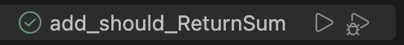
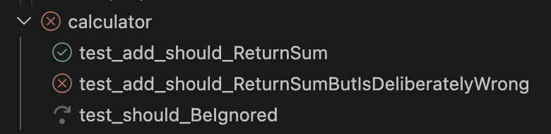
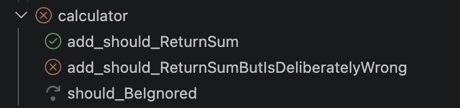
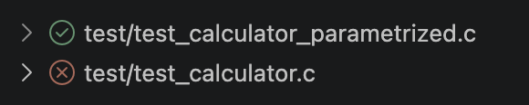
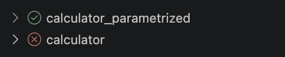

# Running Tests

Tests run from VS Code’s _Testing_ view or from the editor, and their results appear in both. This page covers what each kind of run does in Ceedling, how results are shown, how tests are labeled, and the cleanup commands. Debugging has a page of its own, [Debugging][debugging].

## Where to run tests

Every test in the _Testing_ view has run and debug buttons, and so does every test file. The editor’s gutter shows the same buttons beside each test function and parametrized case.

{ width="276" }

The view groups tests by where they come from. A workspace folder holding several Ceedling projects lists each project, by its [`name`][projects], with its test files beneath it. A folder holding one project lists its test files directly. A workspace with several folders adds an entry per folder, labeled _Ceedling (folder)_.

A run of a test file runs it through Ceedling’s `test:` task. A run of a whole project runs `test:all`. A run covering several projects runs them one after another. Separate runs of projects in different directories may overlap. Commands within one project directory, or in projects sharing a build directory, never overlap, since Ceedling’s builds there would collide.

## A single test

Running a single test function runs only that function, through Ceedling’s `--test-case` filter. Ceedling still compiles the function’s whole test file.

Ceedling’s filter matches by substring, so a filter for `test_Add` also matches `test_AddOverflow`. When the filter matches another test in the file, the extension runs the whole file instead, and reports every test in it. The extension’s log says when that happens.

## Parametrized test cases

Each case of a parametrized test appears beneath its function in the _Testing_ view, as Ceedling runs it. Unity’s `TEST_CASE()`, `TEST_RANGE()`, and `TEST_MATRIX()` all produce cases.

Parametrized tests need one project setting. Unity’s markers take effect only with `:unity` ↳ `:use_param_tests` set to `true`. The _Testing_ view lists each case separately only then.

```yaml
:unity:
  :use_param_tests: true
```

Ceedling 1.0.0 also needs test-file preprocessing off, since its preprocessing loses the markers. Set `:project` ↳ `:use_test_preprocessor` to `:none`, its default, or to `:mocks`. Ceedling 1.1.0 and later handle parametrized tests either way.

Running one case runs all the cases of its function, since Ceedling selects tests by function. Every case reports its own result.

## Results

A run reports each test’s outcome in the _Testing_ view once Ceedling finishes the command that ran it. A failed test shows its message at its failing line, in the _Testing_ view and inline in the editor.

A build that fails marks each of its tests errored, with the build’s error. The _Test Results_ panel holds Ceedling’s full output for each run, with every compiler and linker error. [Problem matching][problem-matching] can also report those errors in the editor and the _Problems_ panel.

A test that crashes is reported as a failure too, through Ceedling’s `:use_backtrace` setting. [Debugging][crashes] explains its choices.

## Test labels

The _Testing_ view shortens test and file labels by default, so long names stay readable. Two settings control it, [`ceedlingExplorer.prettyTestLabel`][pretty-test] and [`ceedlingExplorer.prettyTestFileLabel`][pretty-file].

A test’s label drops its prefix. For example, `test_BlinkTaskShouldToggleLed` becomes `BlinkTaskShouldToggleLed`.

| Off | On |
|---|---|
| { width="320" } | { width="320" } |

A test file’s label drops its path, prefix, and extension. For example, `test/LEDs/test_BlinkTask.c` becomes `BlinkTask`.

| Off | On |
|---|---|
| { width="280" } | { width="280" } |

The prefixes come from the project’s own configuration, `:test_runner` ↳ `:test_prefix` and `:project` ↳ `:test_file_prefix`.

## Clean and Clobber

The _Testing_ view’s toolbar has Clean and Clobber buttons. They run `ceedling clean` and `ceedling clobber` in every Ceedling project in the workspace. Each project’s command waits for any Ceedling build under way in that project to finish. [Configuration][commands] lists their command IDs, for keyboard shortcuts.

## After upgrading Ceedling

Ceedling 1.2.2 builds each test in a new place, and an earlier release’s build output stays until a clobber. After an upgrade from Ceedling 1.2.0 or 1.2.1, the first build offers to clobber the project. Accepting it clobbers once the runs under way finish. After an upgrade from an earlier release, clobber once with the toolbar button. The [Known Issues][known-issues] list the cases where no offer appears.

[debugging]: debugging.md
[projects]: configuration.md#ceedlingexplorerprojects
[problem-matching]: problem-matching.md
[crashes]: debugging.md#crashing-tests
[pretty-test]: configuration.md#ceedlingexplorerprettytestlabel
[pretty-file]: configuration.md#ceedlingexplorerprettytestfilelabel
[commands]: configuration.md#commands
[known-issues]: https://github.com/ThrowTheSwitch/vscode-ceedling/blob/master/docs/KnownIssues.md

<br/><br/>
